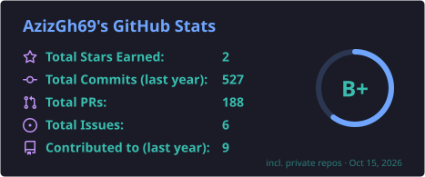
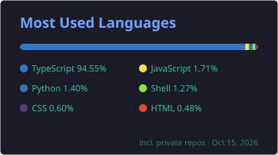

  

## 🧭 About me

I'm a student at **IHEC Carthage** working my way toward **data engineering** and **cloud / solutions architecture**. I like building things end to end, from the data model to the UI to where it runs in the cloud.

- 🔭 **Currently building:** [Kalori](https://kalori-app.com), a food & calorie tracking app (React + TypeScript)
- 🌱 **Learning:** data pipelines & ETL, SQL and data warehousing, cloud architecture on AWS / Azure
- 🎯 **Goal:** design scalable, reliable data platforms in the cloud
- ⚡ **Fun fact:** I also build AI tools for Valorant 🎮

## 🚀 Featured projects

| Project | What it is | Stack |
|---|---|---|
| 🥗 **[Kalori](https://kalori-app.com)** | Food & calorie tracking web app | React · TypeScript · Tailwind · Vite |
| 🎯 **[ValorantAgentAssistant](https://github.com/AzizGh69/ValorantAgentAssistant)** | AI-powered weapon recommendations & tactical scenario training | Python · AI |
| 📚 **[IHEC Library](https://github.com/AzizGh69/ihec_library-)** | Library management system (team project) | C# · SQL |
| 🎓 **[LearnHub](https://github.com/AzizGh69/LearnHub)** | E-learning app (team project) | Java |
| 🃏 **[Chkobba v2](https://github.com/AzizGh69/Chkobba-v2)** | The classic Tunisian card game in the browser | HTML · CSS · JavaScript |
| 💼 **[Portfolio](https://github.com/AzizGh69/Potfolio)** | Personal portfolio site | React · TypeScript · Tailwind |

## 🛠️ Tech stack

**Languages**

  
  
  
  
  
  
  

**Data**

  
  
  
  

**Cloud & DevOps**

  
  
  
  
  

**Web**

  
  
  

## 📊 GitHub stats

  
  
   
  

## 🤝 Connect with me

  
  
  

